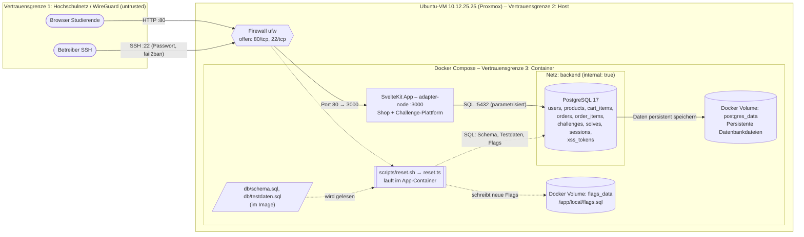

# Sudo-Shop – Planung (Session 2)

| | |
|---|---|
| **Gruppe** | Gruppe 4 |
| **Mitglieder** | Patrick Weiss, Philipp Huber, David Rabensteiner, Michael Mezgolits |
| **Plattformname** | Sudo-Shop |
| **Repository** | https://github.com/p4trickweiss/hcw-ssd-sudo-shop |
| **Abgabestand** | Tag `session-2` (Commit wird beim Taggen eingetragen) |
| **Shop-URL (intern)** | http://10.12.25.25 |
| **Hosting** | Ubuntu-Server-VM auf proxmox.hcw.ac.at |

Der Shop verkauft fiktive Labubu-Sammelfiguren (Blind Boxes, Einzelfiguren, Sondereditionen). Alle Daten und Zahlungen sind fiktiv bzw. simuliert.

---

## S2.1 Funktionale Anforderungen

### Shop – Pflichtstories

Alle Preise werden in der DB als ganze Cent (`integer`) gespeichert, um Rundungsfehler zu vermeiden.

**US01 – Produktkatalog ansehen** (`/products`)
> Als Kundin oder Kunde möchte ich die verfügbaren Produkte ansehen, damit ich Produkte für meinen Einkauf auswählen kann.

- US01-AK1: Der Katalog zeigt mindestens fünf fiktive Produkte mit eindeutiger Kennung, Name und Preis in Euro.
  *Umsetzung:* Es werden mindestens 5 Produkte aus den Testdaten mit Preis im Format `12,90 €` angezeigt.
  *Prüfung:* Nach dem Reset `/products` öffnen und ≥ 5 Einträge mit ID, Name und Preis zählen.
- US01-AK2: Jedes Produkt kann aus dem Katalog heraus ausgewählt werden; die Auswahl öffnet die passende Detailansicht.
  *Umsetzung:* Ein Klick auf ein Produkt öffnet `/products/[id]` mit derselben ID (Ansicht: siehe US02-AK1).
- US01-AK3: Katalog und Detailansicht verwenden dieselben Produktdaten und Preise.
  *Umsetzung:* Beide lesen aus derselben Tabelle `products`; es gibt keine doppelten Preisangaben im Code.
  *Prüfung:* Preis in der DB ändern, dann zeigen beide Seiten den neuen Preis.

**US02 – Produktdetails ansehen** (`/products/[id]`)
> Als Kundin oder Kunde möchte ich die Beschreibung eines Produkts lesen, damit ich entscheiden kann, ob ich es kaufen möchte.

- US02-AK1: Die Detailansicht zeigt Kennung, Name, Beschreibung und Preis des ausgewählten Produkts.
- US02-AK2: Von der Detailansicht kann ich zum Katalog zurückkehren und das Produkt in den Warenkorb legen.
  *Umsetzung:* Es gibt einen Link „Zurück zum Katalog“ und einen Button „In den Warenkorb“ (Menge 1).
- US02-AK3: Ein unbekanntes Produkt wird verständlich als nicht vorhanden angezeigt.
  *Umsetzung:* `/products/9999` und `/products/abc` liefern HTTP 404 mit der Seite „Produkt nicht gefunden“, ohne Stacktrace.

**US03 – Warenkorb bearbeiten** (`/cart`)
> Als Kundin oder Kunde möchte ich Produkte und Mengen in meinem Warenkorb bearbeiten, damit ich meinen Einkauf zusammenstellen kann.

- US03-AK1: Produkte können hinzugefügt, Mengen auf positive ganze Zahlen geändert und Positionen entfernt werden.
  *Prüfung:* Menge 3 setzen, dann zeigt die Position 3. Nach „Entfernen“ ist die Position weg.
- US03-AK2: Der Warenkorb zeigt je Position Produkt, Menge, Einzelpreis und Zwischensumme sowie die Gesamtsumme. Summen stimmen für gültige Eingaben.
  *Prüfung:* 2 × 12,90 € + 1 × 5,00 € ergibt 30,80 €.
- US03-AK3: Der Warenkorb bleibt beim Wechsel zwischen Shopseiten erhalten. Ein leerer Warenkorb wird verständlich angezeigt.
  *Umsetzung:* Der Warenkorb liegt serverseitig in der DB (`cart_items`, dem angemeldeten Testkonto zugeordnet); ist er leer, steht dort „Dein Warenkorb ist leer“ mit einem Link zum Katalog.
- *Bewusste Abweichung:* In beiden Betriebsmodi (sicher und unsicher) sind nur ganze Mengen von 1 bis 99 zulässig. Serverprüfung und DB-Constraint erzwingen das. C3 betrifft ausschließlich die mehrfache Einlösung desselben Gutscheins.

**US04 – Bestellung simuliert abschließen** (`/checkout`)
> Als Kundin oder Kunde möchte ich meinen Warenkorb bestellen, damit ich den vollständigen Kaufprozess testen kann.

- US04-AK1: Vor dem Abschluss sehe ich eine Bestellübersicht mit Produkten, Mengen und Gesamtsumme.
- US04-AK2: Ein nicht leerer Warenkorb kann über eine eindeutig als Simulation bezeichnete Aktion bestellt werden. Ein leerer Warenkorb erzeugt keine Bestellung.
  *Umsetzung:* Der Button heißt **„Bestellung simulieren“**; bei leerem Warenkorb ist er deaktiviert, und der Server lehnt den Request mit 400 ab.
  *Prüfung:* POST mit leerem Warenkorb, dann bleibt die Anzahl der Zeilen in `orders` gleich.
- US04-AK3: Es werden nur fiktive Bestelldaten und simulierte Zahlungen verwendet. Eine Bestellung löst weder eine reale Zahlung noch Versand aus.
  *Umsetzung:* Es gibt keine Anbindung an Zahlungs- oder Versanddienste; die „Zahlung“ ist nur ein Statusfeld `payment = 'simulated'`.

**US05 – Bestellbestätigung erhalten** (`/orders/[id]`)
> Als Kundin oder Kunde möchte ich eine Bestätigung meines Einkaufs erhalten, damit ich meine Bestellung nachvollziehen kann.

- US05-AK1: Nach dem Abschluss erscheinen eine eindeutige Bestellnummer, die bestellten Positionen und die Gesamtsumme.
  *Umsetzung:* Nach dem Abschluss folgt eine Weiterleitung auf `/orders/[id]`; die Bestellnummer ist eine fortlaufende ID.
- US05-AK2: Die Bestellung wird serverseitig gespeichert und stimmt im normalen Ablauf mit der bestätigten Übersicht überein. Die Speicherung ist nachweisbar.
  *Umsetzung:* Gespeichert wird in `orders` und `order_items`, inklusive Preis-Snapshot zum Bestellzeitpunkt.
  *Prüfung:* `SELECT * FROM orders WHERE id = …` stimmt mit der Bestätigungsseite überein.
- US05-AK3: Der Warenkorb ist nach erfolgreicher Bestellung leer; ein weiterer Einkauf ist möglich.

**US08 – Ausgangszustand wiederherstellen**
> Als Betreiberin oder Betreiber möchte ich den Shop zurücksetzen, damit Einkäufe wiederholt getestet werden können.

- US08-AK1: Ein dokumentierter Befehl, ein Skript oder eine Oberfläche stellt Produkte und Testkonten wieder her und setzt Warenkörbe und Bestellungen auf den dokumentierten Ausgangszustand zurück.
  *Umsetzung:* `docker compose exec app ./scripts/reset.sh` führt im App-Container `scripts/reset.ts` aus. Das Skript legt das Schema an, leert die Tabellen und spielt `db/testdaten.sql` ein. Anschließend erzeugt es neue Passwort-Salts und drei neue Flags, schreibt `/app/local/flags.sql` im Volume `flags_data` und spielt diese Datei ein. Die Datenbankänderungen laufen in einer Transaktion. Alte Flags sind nach einem erfolgreichen Reset ungültig.
- US08-AK2: Nach dem Reset funktionieren Testkonten und der normale Kaufprozess erneut.
- US08-AK3: Das Git-Repository beschreibt Voraussetzungen, Start und Reset so, dass die Lehrperson sie ausführen kann.
  *Umsetzung:* Das README beschreibt Voraussetzungen, Start, Stop und Reset (siehe S2.7).

**US09 – Testkonten nutzen** (`/login`, `/logout`, `/orders`)
> Als Kundin oder Kunde möchte ich mich mit einem Testkonto anmelden, damit ich meine Einkäufe durchführen und meine Bestellungen ansehen kann.

- US09-AK1: Mindestens zwei fiktive Kundenkonten sind vorbereitet. Anmelden und Abmelden funktionieren.
  *Umsetzung:* Die Testkonten heißen `alice` und `bob`, das fiktive Passwort ist jeweils `labubu123`. `scripts/reset.ts` erzeugt für jedes Konto einen zufälligen Salt und einen scrypt-Hash. `users.password_hash` speichert `salt:hash`; `db/testdaten.sql` enthält zunächst nur deaktivierte Platzhalter. Das interne Konto `admin` bleibt nicht einloggbar.
- US09-AK2: Bestellungen sind dem jeweiligen Testkonto zugeordnet. Angemeldete Kundinnen und Kunden können ihre eigenen Bestellungen mit Bestellnummer, Positionen und Gesamtsumme ansehen. Bewusste Abweichungen bei Zugriffsrechten sind als Challenge dokumentiert.
  *Umsetzung:* `/orders` listet nur die eigenen Bestellungen.
  *Prüfung:* Alice sieht Bobs Bestellung in der Liste nicht.
- *Bewusste Abweichung:* Die Detailroute `/orders/[id]` prüft den Besitzer nicht. Das ist Challenge **C1 (A01)**.

### Challenge-Plattform (getrennte Anforderungen)

- CP-1: `/challenges` listet alle drei Challenges mit Titel, OWASP-Kategorie, Ziel, Einstieg, Vorbedingungen und Erfolgskriterium.
- CP-2: Jede Challenge liefert bei Erfolg ein Flag im Format `SUDO{…}`. Ein Formular prüft eingereichte Flags serverseitig und zeigt „gelöst / falsch“.
- CP-3: `challenges.flag_hash` enthält ausschließlich SHA-256-Prüfwerte. Die notwendigen Klartext-Ausgabequellen sind die fremde Bestellnotiz (C1), Bobs private Notiz (C2) und der serverseitige Reward des Flag-Produkts (C3). Der Produkt-Reward wird nicht in Katalog, Details, Suche oder Warenkorb ausgeliefert. Zusätzlich enthält die generierte Datei `/app/local/flags.sql` im Docker-Volume die für den Reset erzeugten Werte; sie ist nicht Teil des Repositorys.
- CP-4: Gelöste Challenges werden pro Benutzer in `solves` gespeichert und in der Liste markiert. Ein Reset löscht `solves`.
- CP-5: Hinweise sind optional aufklappbar.

---

## S2.2 Sicherheitsanforderungen

**Schutzbedarf**

| Schutzobjekt | Vertraulichkeit | Integrität  | Begründung |
|---|---|---|---|
| Server/VM, Docker-Host | hoch | hoch | Angreifer kann den ganzen Shop kontrollieren und andere VMs im WireGuard-Netz erreichen |
| Datenbank-Zugang, Secrets (`.env`) | hoch | hoch | Infrastruktur-Zugangsdaten, nicht Teil des Challenge-Bereichs |
| Kundenkonten / Passwörter | mittel | hoch | gehasht |
| Bestellungen, Warenkörbe | mittel | mittel | absichtlich Teil der Challenges, per Reset wiederherstellbar |
| Flags | mittel | hoch | dürfen nur durch Lösen der Challenge erlangt werden |

**Sicherheitsanforderungen mit Prüfkriterien**

| ID | Anforderung (erlaubt / unerlaubt) | Prüfkriterium | Bewusste Abweichung |
|---|---|---|---|
| SR-01 | Nur angemeldete Benutzer sehen Bestellungen; jeder nur seine eigenen | Alice ruft Bobs Bestellung auf → 404 | **C1 (A01)** auf `/orders/[id]` |
| SR-02 | Benutzereingaben werden bei der Ausgabe kontextgerecht kodiert | Suchbegriff `<b>x</b>` erscheint als Text, nicht fett | **C2 (A05)** auf `/search` |
| SR-03 | Mengen werden serverseitig auf ganze Zahlen von 1 bis 99 geprüft; Preise und Rabatte werden serverseitig berechnet; jeder Gutscheincode darf pro Bestellung höchstens einmal gelten | Ungültige Menge → 400, DB unverändert; im sicheren Modus zweite Einlösung desselben Codes → 400; Checkout lehnt gespeicherte Duplikate ebenfalls ab | **C3 (A06):** Im Challenge-Modus darf derselbe Code bis zu fünfmal eingelöst werden; Mengenvalidierung bleibt intakt |
| SR-04 | Datenbankzugriffe nur mit parametrisierten Queries | Code-Review: kein String-Concat in SQL; `'` in Suche → kein Fehler | keine |
| SR-05 | Passwörter nur als Hash gespeichert | `SELECT password_hash FROM users` enthält keinen Klartext | keine |
| SR-06 | Session-Cookie `HttpOnly`, `SameSite=Lax`, zufällige ID (≥ 128 Bit) | Cookie in DevTools prüfen | keine |
| SR-07 | Fehlermeldungen ohne Stacktrace, SQL oder Pfade; Details nur ins Server-Log | Ungültige ID / kaputter Request → generische Fehlerseite | keine |
| SR-08 | Reset und Administration sind nicht über das Web erreichbar | Es gibt keine Route `/reset` o. ä.; Reset nur per Docker-Kommando des Betreibers; später auf der VM über den administrativen Zugang | keine |
| SR-09 | Die Schwachstellen bleiben auf die Anwendungsebene beschränkt: keine Codeausführung auf dem Server, kein Zugriff auf Dateisystem, Netzwerk oder Container-Host | Code-Review: kein `eval`/`exec`/Shell-Aufruf mit Benutzereingabe | keine |

---

## S2.3 Architekturdiagramm



**Erklärung des Diagramms**

Eine Anfrage läuft so: Browser → WireGuard → VM `10.12.25.25` → Firewall → SvelteKit-App → Datenbank, und die fertige Seite geht denselben Weg zurück.

- **Browser Studierende:** Wer die Challenges spielt, ist per WireGuard im Hochschulnetz und ruft `http://10.12.25.25` auf.
- **Betreiber SSH:** Wir als Gruppe loggen uns per SSH (Benutzername + Passwort) auf der VM ein, um den Shop zu starten, zu stoppen und zurückzusetzen.
- **Firewall (ufw):** Die Standard-Firewall von Ubuntu legt fest, auf welchen Ports die VM Verbindungen von außen annimmt. Offen sind nur **Port 80** (HTTP, der Shop) und **Port 22** (SSH, Administration). Alle anderen Ports, z. B. 5432 für die Datenbank, sind zu.
- **SvelteKit-App:** Unsere Anwendung (Shop + Challenge-Plattform) läuft im Container auf Port 3000. Docker leitet Port 80 der VM auf Port 3000 des Containers weiter (`ports: "80:3000"`). Die App läuft dadurch ohne Root-Rechte und ist trotzdem unter der normalen Web-Adresse erreichbar.
- **PostgreSQL:** Die Datenbank läuft in einem eigenen Container in einem internen Docker-Netz. Nur die App kann sie erreichen. Die Datenbankdateien werden in einem persistenten, benannten Docker-Volume `postgres_data` gespeichert. Dadurch bleiben die Daten auch nach einem Neustart oder `docker compose down` erhalten.
- **reset.sh:** Ein Skript im App-Container, das wir nach dem SSH-Login mit `docker compose exec app ./scripts/reset.sh` ausführen. Es startet `scripts/reset.ts`, legt das Schema an, leert die Tabellen und spielt die Testdaten neu ein. Über den Browser ist es nicht erreichbar. Beim allerersten Start ruft `scripts/init.ts` dasselbe Skript automatisch auf, wenn die Datenbank noch leer ist.
- **Testdaten und Flags:** `db/schema.sql` und `db/testdaten.sql` liegen im Repo und werden beim Bauen ins Image kopiert. Es gibt keinen Bind Mount. `reset.ts` erzeugt bei jedem Reset neue Passwort-Hashes und drei zufällige Flags, schreibt diese nach `/app/local/flags.sql` im Volume `flags_data` und spielt sie in die Datenbank ein. Die Flags stehen damit nie im Repo und müssen nicht manuell angelegt werden.

Durchgezogene Pfeile sind der normale Shop-Betrieb, gestrichelte Pfeile sind Administration durch uns.

**Datenflüsse**
1. Browser → App: HTML-Seiten, Form-Actions (Login, Warenkorb, Checkout, Flag-Abgabe)
2. App → DB: Lesen/Schreiben aller Fachdaten, Sessions
3. Betreiber → VM (SSH) → `docker compose exec app` → Reset-Skript → DB und Volume `flags_data`: Wiederherstellen des Ausgangszustands mit neuen Flags

**Vertrauensgrenzen**
- **TB1 Netz → VM:** Alle Anfragen aus dem Netz gelten als nicht vertrauenswürdig. Nur Port 80 (Shop) und 22 (Admin) sind offen.
- **TB2 Host → Container:** Die App läuft isoliert, ohne Zugriff auf Host-Dateisystem oder Docker-Socket.
- **TB3 App → DB:** Die DB ist nur im internen Docker-Netz erreichbar. Die App und das Reset-Skript nutzen denselben DB-User `sudo` (Eigentümer der Datenbank, da das Schema beim Start angelegt wird). Ein getrennter DB-User mit eingeschränkten Rechten ist nicht umgesetzt und gilt als bekannte Einschränkung.
- Die Challenge-Schwachstellen liegen **ausschließlich innerhalb der App** (Grenze TB1 → App). Keine überschreitet TB2 oder TB3.

---

## S2.4 Sicherheitsmaßnahmen und Schutzgrenzen

**Kontrollstellen in der Anwendung**
- `hooks.server.ts`: Die Session wird pro Request geladen. Geschützte Routen (`/cart`, `/checkout`, `/orders`) leiten ohne Login auf `/login` um.
- Zentrale Validierung (zod-Schemas) für Login, Flag-Abgabe und Checkout, mit Ausnahme der dokumentierten C3-Stelle
- Preise werden beim Checkout immer serverseitig aus `products` berechnet
- `handleError`-Hook: Der Client bekommt nur eine generische Meldung plus Fehler-ID, die Details landen im Container-Log.
- Security-Header setzt die App selbst in `hooks.server.ts`: `X-Content-Type-Options`, `Referrer-Policy`, `X-Frame-Options`. Die CSP ist auf `/search` absichtlich gelockert (C2) und auf allen anderen Seiten restriktiv.
- Rate-Limit in der App auf `/login` und die Flag-Abgabe, damit kein Brute-Force möglich ist

**Abgrenzung gegenüber Host und Infrastruktur**
- `ufw default deny incoming`, freigegeben sind nur 22/tcp und 80/tcp. Postgres wird **nicht** veröffentlicht (kein `ports:` im db-Service).
- Docker-Portfreigaben (`ports:`) umgehen ufw. Deshalb wird in `compose.yaml` ausschließlich `80:3000` für die App veröffentlicht.
- Container laufen als Nicht-Root-User (`user: node`) mit `read_only: true`, `cap_drop: [ALL]` und `security_opt: [no-new-privileges:true]`. Der Docker-Socket wird nicht gemountet.
- Ressourcenlimits (`mem_limit`, `cpus`, `pids_limit`), damit eine Überlast den Host nicht lahmlegt
- Secrets: Das DB-Passwort steht in `compose.yaml` (`DATABASE_URL`, `POSTGRES_PASSWORD`). Die Datenbank ist nicht veröffentlicht und nur im internen Netz erreichbar. Ein Session-Secret gibt es nicht, denn Sessions sind zufällige IDs in der Datenbank. Die Flags entstehen bei der Initialisierung und bei jedem Reset im Volume `flags_data` (`/app/local/flags.sql`, Dateirechte `0600`) und stehen nie im Repo. `.env` und `db/flags.sql` stehen in `.gitignore`.
- Volumes: Es gibt zwei benannte Docker-Volumes: `postgres_data` für die Datenbankdateien und `flags_data` für die generierten Flags der App.
- SSH: Login mit Benutzername und starkem, individuellem Passwort; `PermitRootLogin no`; `fail2ban` sperrt IP-Adressen nach mehreren fehlgeschlagenen Login-Versuchen. Unattended Upgrades sind aktiv.

**Abgrenzung gegenüber anderen Gruppen und Hochschulsystemen**
- Die App macht keine ausgehenden Requests (kein SSRF-Vektor, keine Webhooks). Die Datenbank liegt im `internal`-Netz und hat keinen Netzzugang nach außen.
- Die Challenges betreffen nur Shop-Daten bzw. den Browser der eigenen Nutzer. Proxmox, WireGuard und Systeme anderer Gruppen sind auf der Challenge-Seite ausdrücklich als „keine Ziele“ gekennzeichnet.
- Auf der VM liegen keine Infrastruktur-Zugangsdaten (Proxmox, HCW-Portal).

**Fehlerbehandlung**
- Unbekannte Ressourcen liefern 404, ungültige Eingaben 400, fehlende Anmeldung führt per 303 auf `/login`.
- Datenbankfehler werden geloggt, der Nutzer bekommt eine 500er-Seite ohne Details.
- Healthcheck `GET /health` für Docker (`restart: unless-stopped`)

---

## S2.5 Begründete Architektur- und Technologieentscheidungen

**E1: SvelteKit (Full-Stack, adapter-node) statt getrenntem Frontend + REST-Backend (z. B. React + Express)**

| | SvelteKit Full-Stack (gewählt) | React SPA + Express API |
|---|---|---|
| Vorteile | Ein Codebase, ein Container; Server-Load-Funktionen und Form-Actions halten die Logik serverseitig; Svelte escaped Ausgaben standardmäßig (gut, um sichere vs. unsichere Variante bei C2 zu zeigen); Team hat Vorerfahrung | Klare API-Grenze, gut für API-basierte Challenges (z. B. per curl); große Community |
| Nachteile | Weniger verbreitet; Server-/Client-Grenze für Einsteiger weniger sichtbar | Zwei Projekte, CORS- und Auth-Token-Handling nötig; mehr Aufwand |

**Entscheidung:** SvelteKit, weil der Umfang mit vier Personen in drei Wochen realistisch bleibt und eine kleinere Angriffsfläche (kein CORS) die Abgrenzung erleichtert.

**E2: PostgreSQL statt SQLite**
- Pro Postgres: realistische Mehrbenutzer-DB, `CHECK`-Constraints für die sichere Korrektur von C3, eigener Container und damit sauberer Reset durch Einspielen der Testdaten
- Contra Postgres: zusätzlicher Container und mehr RAM
- SQLite wäre einfacher (eine Datei, Reset durch Kopieren), hat aber kein Rechtemodell und mischt App- und Datenschicht im selben Container.

**E3: Docker Compose statt nativer Installation auf der VM:** reproduzierbarer Start und Reset für die Lehrperson (US08-AK3) und Container-Isolation (S2.4). Der Nachteil ist der zusätzliche Docker-Layer auf der VM.

---

## S2.6 Challenge-Steckbriefe

> Die Musterlösungen (Schritt-für-Schritt) stehen **nicht** in diesem Dokument und nicht im Shop. Da das Repository öffentlich ist, liegen sie dort auch nicht. Die Musterlösungen folgen separat per E-Mail an die Lehrperson.

### C1 – „Fremde Quittung“ (IDOR)

| Feld | Inhalt |
|---|---|
| **OWASP** | A01:2025 – Broken Access Control |
| **CWE** | [CWE-639: Authorization Bypass Through User-Controlled Key](https://cwe.mitre.org/data/definitions/639.html). Die Bestell-ID aus der URL wird als einziger Schlüssel genutzt, ohne zu prüfen, ob die Bestellung dem angemeldeten Benutzer gehört. Verwandt: CWE-862 Missing Authorization. |
| **CVE** | Didaktische Nachbildung mit Bezug auf [CVE-2025-65647](https://www.cve.org/CVERecord?id=CVE-2025-65647). Originalprodukt: PHPGurukul Online Shopping Portal, betroffene Version 2.1. In der Funktion „Track order“ kann ein angemeldeter Benutzer über den Parameter `oid` Bestellinformationen anderer Benutzer abrufen. |
| **Lernziel** | Authentifizierung (wer bin ich) von Autorisierung (darf ich das Objekt sehen) unterscheiden; Objektzugriffe immer gegen den Besitzer prüfen |
| **Ursache** | `SELECT … FROM orders WHERE id = $1` ohne Bedingung auf `user_id` |
| **Verletzte Regel** | SR-01 |
| **Shopbezug** | Bestellbestätigung / Bestelldetail `/orders/[id]` (US05, US09) |
| **Auftrag** | „Ein anderer Kunde hat etwas Besonderes bestellt. Finde heraus, was.“ |
| **Einstieg / Vorbedingungen** | Login als `alice`, eine eigene Bestellung ansehen |
| **Testdaten** | `alice`, `bob`; vordefinierte Bestellung eines Kontos `admin` (nicht einloggbar) mit Flag in der Bestellnotiz |
| **Hinweise** | 1) „Schau dir die URL deiner Bestellung genau an.“ |
| **Erfolgskriterium** | Flag `SUDO{…}` aus der fremden Bestellung wird auf `/challenges` akzeptiert |
| **Sicherheitswirkung** | Verlust der Vertraulichkeit fremder Bestelldaten |
| **Reset** | `./scripts/reset.sh` stellt die Bestellung aus den Testdaten wieder her und leert `solves` |
| **Sichere Korrektur** | Query auf `WHERE id = $1 AND user_id = $2` (Session-User) ändern; bei keinem Treffer 404 statt 403, damit die Existenz nicht verraten wird |
| **Prüfszenario** | Als `alice` die ID einer Bestellung von `bob` aufrufen → **erwartet: 404**. Eigene Bestellung → 200. Ohne Login → Redirect `/login`. |

### C2 – „Suchmaschinen-Optimierung“ (reflektiertes XSS / Datenleck)

| Feld | Inhalt |
|---|---|
| **OWASP** | A05:2025 – Injection (vorgegebene Kategorie) |
| **CWE** | [CWE-79: Improper Neutralization of Input During Web Page Generation (Cross-site Scripting)](https://cwe.mitre.org/data/definitions/79.html). Der Suchbegriff aus `?q=` wird unkodiert als HTML ausgegeben (reflektiertes XSS). |
| **CVE** | Didaktische Nachbildung mit Bezug auf [CVE-2020-5272](https://www.cve.org/CVERecord?id=CVE-2020-5272). Originalprodukt: PrestaShop; reflektiertes XSS auf der Suchseite über Suchparameter. |
| **Lernziel** | Zeigen, dass XSS mehr als ein `alert()` auslösen kann: Fremder JavaScript-Code läuft im Kontext eines eingeloggten Shopkunden und kann fiktive private Shopdaten offenlegen. |
| **Ursache** | Die Suchseite gibt den Parameter `q` über `{@html}` statt als escaped Text aus; die CSP ist ausschließlich auf `/search` für die Challenge gelockert. |
| **Verletzte Regel** | SR-02 |
| **Shopbezug** | Produktsuche `/search?q=…` und private, fiktive Bestellnotiz eines Kunden |
| **Auftrag** | „Präpariere einen Suchlink, über den du die private Bestellnotiz eines anderen Testkunden erhältst.“ |
| **Einstieg / Vorbedingungen** | Alice ist Angreiferin und erstellt einen manipulierten Suchlink. Bob ist als fiktiver Kunde in einem separaten Browserprofil eingeloggt und öffnet den Link bei der manuellen Vorführung. Kein automatischer Opfer-Bot nötig. |
| **Testdaten** | `alice`, `bob`; Bob besitzt eine nur für seine Sitzung zugängliche fiktive VIP-Bestellnotiz (nicht identisch mit dem Flag aus C1). |
| **Hinweise** | 1) „Was passiert mit deinem Suchbegriff im HTML?“ 2) „Welche Shopdaten darf Bob sehen, Alice aber nicht?“ |
| **Erfolgskriterium** | Alice verknüpft einen Angriff mit ihrer Challenge-Sitzung und platziert den entsprechenden Code im Suchlink. Der in Bobs Browser ausgeführte Code ruft mit **Bobs Sitzung** die private Notiz von einer nur für Bob autorisierten Shoproute ab und sendet sie per `POST /api/challenges/c2/collect` an den **eigenen Shop**. Der Collector nimmt nur die vorgesehenen fiktiven Challenge-Daten an, prüft die Zuordnung zu Alices Angriff sowie Bobs Sitzung und speichert den Leak. Alice sieht die abgefangene Notiz in ihrer Challenge-Ansicht und erhält das Flag `SUDO{…}`. Ein bloßer `alert()` genügt nicht. |
| **Sicherheitswirkung** | Verlust der Vertraulichkeit privater Kundendaten durch JavaScript-Ausführung in einer fremden Browsersitzung. Keine Übertragung an externe Domains oder Zugriff auf echte Daten. |
| **Reset** | `./scripts/reset.sh` stellt Bobs fiktive Notiz wieder her und löscht Angriffszuordnungen, gesammelte Leaks und `solves`. |
| **Sichere Korrektur** | `{@html …}` durch normales `{query}` ersetzen; restriktive CSP auch auf `/search` aktivieren. |
| **Prüfszenario** | Im sicheren Modus zeigt `/search?q=<b>test</b>` die Zeichenfolge nur als Text. Nach einem Reset zuerst eine neue Angriffskennung als Alice erzeugen und diese im Prüflink verwenden; dann darf der Link in Bobs Profil keinen Code ausführen und keinen Collector-Eintrag erzeugen. Alte Kennungen sind durch den Reset ungültig und kein geeigneter Nachweis für die Korrektur. |


### C3 – „Gutschein-Chaos“ (fünffacher Rabatt)

| Feld | Inhalt                                                                                                                                                                                                                                                                                                                                                                                                                                                                                                                                                                                                                                  |
|---|-----------------------------------------------------------------------------------------------------------------------------------------------------------------------------------------------------------------------------------------------------------------------------------------------------------------------------------------------------------------------------------------------------------------------------------------------------------------------------------------------------------------------------------------------------------------------------------------------------------------------------------------|
| **OWASP** | A06:2025 – Insecure Design                                                                                                                                                                                                                                                                                                                                                                                                                                                                                                                                                                                                              |
| **CWE** | [CWE-837: Improper Enforcement of a Single, Unique Action](https://cwe.mitre.org/data/definitions/837.html). Die Geschäftslogik erzwingt die vorgesehene Regel zur einmaligen Gutscheineinlösung nicht, wodurch derselbe Rabatt mehrfach angewendet werden kann. Die Demo erlaubt höchstens fünf Einlösungen.                                                                                                                                                                                                                                                                                                                           |
| **CVE** | Didaktische Nachbildung mit Bezug auf [CVE-2026-112285](https://www.cve.org/CVERecord?id=CVE-2026-112285). Originalprodukt: Thelia, betroffen sind Versionen ab 2.6.2 und vor 3.1.5 sowie ab 3.2.0 und vor 3.2.4. Gutscheinnutzungen werden erst bei bezahlten Bestellungen gezählt. Mehrere Bestellungen mit späterer Zahlung oder Stornierungen erlauben dadurch zusätzliche Einlösungen.|
| **Lernziel** | Fehlende Geschäftsregeln im Design erkennen: Einzeln gültige Gutscheinanwendungen führen durch unerlaubte Kombination zu einem falschen Bestellbetrag.                                                                                                                                                                                                                                                                                                                                                                                                                                                                                  |
| **Ursache** | Beim Entwurf des Checkout-Prozesses wurde nicht festgelegt bzw. durchgesetzt, dass derselbe Gutschein höchstens einmal pro Bestellung gelten darf. Im Challenge-Modus akzeptiert die Anwendung bis zu fünf Einlösungen als zusätzliche Rabatte, jeweils berechnet aus dem ursprünglichen Warenkorbwert.                                                                                                                                                                                                                                                                                                                                 |
| **Verletzte Regel** | SR-03 (fehlende verbindliche Gutschein- und Rabattregeln)                                                                                                                                                                                                                                                                                                                                                                                                                                                                                                                                                                               |
| **Shopbezug** | Gutscheine, Warenkorb und simulierter Checkout (US03, US04)                                                                                                                                                                                                                                                                                                                                                                                                                                                                                                                                                                             |
| **Auftrag** | „Das Produkt ‚Golden Labubu (Flag)‘ kostet 1.337,00 €. Dein Guthaben beträgt 20,00 €. Nutze den Gutscheinfehler, um es trotzdem zu bestellen.“                                                                                                                                                                                                                                                                                                                                                                                                                                                                                          |
| **Einstieg / Vorbedingungen** | Login als `bob`; fiktives Guthaben 20,00 € (`users.balance`); Produkt „Golden Labubu (Flag)“ im Warenkorb                                                                                                                                                                                                                                                                                                                                                                                                                                                                                                                               |
| **Testdaten** | Gutschein mit 20 % Rabatt, der laut Geschäftsregel pro Bestellung **nur einmal** angewendet werden dürfte. Preise und Rabatte werden als ganze Cent berechnet.                                                                                                                                                                                                                                                                                                                                                                                                                                                                          |
| **Hinweise** | 1) „Was passiert, wenn du denselben Gutscheincode erneut einlöst?“                                                                                                                                                                                                                                                                                                                                                                                                                                                                                                                                                                      |
| **Erfolgskriterium** | Der verwundbare Shop akzeptiert den **gleichen 20-%-Code fünfmal**. Jede Anwendung zieht 20 % des **ursprünglichen** Produktpreises ab: 5 × 267,40 € = 1.337,00 € Rabatt. Endbetrag: 0,00 €. Bob kann das Flag-Produkt erfolgreich simuliert bestellen; Bestellung und Rabattpositionen sind in der DB nachvollziehbar. Die Bestellbestätigung zeigt das Flag `SUDO{…}`.                                                                                                                                                                                                                                                                |
| **Sicherheitswirkung** | Integritätsverlust der Preis- und Bestelllogik: Ein hochpreisiges Produkt wird aufgrund einer unzulässigen Rabattkombination kostenlos bestellt.                                                                                                                                                                                                                                                                                                                                                                                                                                                                                        |
| **Reset** | `./scripts/reset.sh` stellt Gutscheine, Warenkörbe, Bestellungen, Guthaben und `solves` zurück.                                                                                                                                                                                                                                                                                                                                                                                                                                                                                                                                         |
| **Sichere Korrektur** | Eine explizite Gutscheinregel entwerfen und serverseitig beim Einlösen **und** beim Checkout erzwingen: jeder Code höchstens einmal pro Bestellung, zulässige Kombinationen festlegen, Rabatte serverseitig und transaktional neu berechnen. Normale Mengenvalidierung bleibt intakt.                                                                                                                                                                                                                                                                                                                                                   |
| **Prüfszenario** | In der sicheren Variante wird die zweite Anwendung desselben Gutscheins abgelehnt, die erste bleibt gültig. Die Bestellung darf durch die fünffache Anwendung nicht mehr auf 0,00 € sinken; normale Käufe funktionieren weiterhin.                                                                                                                                                                                                                                                                                                                                                                                                      |

---

## S2.7 Arbeits- und Betriebsplan

**Zuständigkeiten**

| Person | Hauptverantwortung | Challenge |
|---|---|---|
| Patrick Weiss | Repo/Review, DB-Schema, Testdaten, Reset-Skript | C1 IDOR |
| Philipp Huber | Auth/Sessions, Challenge-Plattform (Flag-Abgabe) | C2 XSS |
| David Rabensteiner | Shop-Frontend (Katalog, Details, Warenkorb, Checkout) | C3 Gutschein-Chaos |
| Michael Mezgolits | VM, Docker Compose, ufw/fail2ban/Hardening, Betriebsanleitung | Prüfszenarien aller Fixes |

**Umsetzungsschritte**

| Zeitraum | Schritt | Ergebnis |
|---|---|---|
| bis 18.10. | adapter-node, Dockerfile, `compose.yaml`, DB-Schema + Testdaten, Reset-Skript | `docker compose up` startet App + DB auf der VM |
| bis 25.10. | US01–US05, US09 (Login, Katalog, Warenkorb, Checkout, Bestellübersicht) | normaler Kaufprozess läuft |
| bis 29.10. | Challenge-Plattform, C1–C3 einbauen, Flags in den Testdaten anlegen | alle Challenges lösbar |
| bis 02.11. | Sichere Korrekturen als Branch `fix/*` bzw. Feature-Flag, Prüfszenarien, Hardening | Fixes + Tests dokumentiert |
| bis 05.11. | Gegenseitiges Testen, Doku, Präsentation | Abgabestand |
| 06.11. | Präsentation + Live-Demo | |

**Git-Repository und Zugriff**
- GitHub: `p4trickweiss/hcw-ssd-sudo-shop` (**öffentlich**). Jede Person, auch die Lehrperson, kann es ohne Einladung lesen. Schreibzugriff haben nur die vier Gruppenmitglieder.
- Folgen der Öffentlichkeit:
  - Flags stehen **nicht** im Repo. `db/testdaten.sql` enthält keine Flags. Die Flags entstehen bei Erstinitialisierung und jedem Reset im App-Container unter `/app/local/flags.sql`, gespeichert im Volume `flags_data`. Die Datei liegt außerhalb des Repositorys. Es gibt keine manuell zu kopierende Flag-Vorlage.
  - Musterlösungen liegen nicht im Repo, auch nicht in einem Branch (Branches sind ebenfalls öffentlich).
  - Der Quellcode inkl. der Schwachstellen ist einsehbar. Das nehmen wir bewusst in Kauf: Die Challenges bleiben lösbar und lehrreich, ein Blick in den Code ersetzt nicht das Ausnutzen im laufenden Shop, und ohne Flag gibt es keinen Erfolgsnachweis.
- Workflow: Feature-Branches (`feature/…`), Pull Request, Merge auf `main`
- Musterlösungen folgen separat per E-Mail an die Lehrperson. `.env` und `db/flags.sql` werden nie committet.

**Laufzeitvoraussetzungen (VM)**
- Ubuntu Server (Proxmox-VM), Docker Engine ≥ 27 mit Compose-Plugin, git, ufw, fail2ban
- Erreichbar über WireGuard (HCW-Konfiguration), Shop unter **http://10.12.25.25**
- Lokal: Docker oder Podman mit Compose. Node.js und pnpm sind auf dem Host nicht nötig, gebaut wird im Container (Image `node:24`). Die Datenbank ist nicht auf dem Host erreichbar, daher läuft die Entwicklung im Container.

**Start / Stop / Reset** (auf der VM, per SSH)
```bash
git clone git@github.com:p4trickweiss/hcw-ssd-sudo-shop.git && cd hcw-ssd-sudo-shop
# In compose.yaml bei build.args: APP_ORIGIN auf http://10.12.25.25 setzen
docker compose up -d --build --wait    # Start (baut neu, wartet auf Healthcheck)
docker compose ps                      # Status / Healthcheck
docker compose down                    # Stop (Daten bleiben in den Volumes erhalten)
docker compose exec app ./scripts/reset.sh   # Reset: Testdaten neu, neue Flags
```

