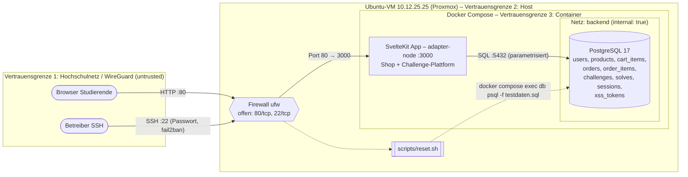

# Sudo-Shop – Planung (Session 2)

| | |
|---|---|
| **Gruppe** | Gruppe 4 |
| **Mitglieder** | Patrick Weiss, Philipp Huber, David Rabensteiner, Michael Mezgolits |
| **Plattformname** | Sudo-Shop |
| **Repository** | https://github.com/p4trickweiss/hcw-ssd-sudo-shop |
| **Abgabestand** | Tag `session-2` (Commit wird beim Taggen eingetragen) |
| **Shop-URL (intern)** | http://10.12.25.25 |
| **Hosting** | Ubuntu-Server-VM auf proxmox.hcw.ac.at |

Der Shop verkauft fiktive Labubu-Sammelfiguren (Blind Boxes, Einzelfiguren, Sondereditionen). Alle Daten und Zahlungen sind fiktiv bzw. simuliert.

---

## S2.1 Funktionale Anforderungen

### Shop – Pflichtstories

Alle Preise werden in der DB als ganze Cent (`integer`) gespeichert, um Rundungsfehler zu vermeiden.

**US01 – Produktkatalog ansehen** (`/products`)
> Als Kundin oder Kunde möchte ich die verfügbaren Produkte ansehen, damit ich Produkte für meinen Einkauf auswählen kann.

- US01-AK1: Der Katalog zeigt mindestens fünf fiktive Produkte mit eindeutiger Kennung, Name und Preis in Euro.
  *Umsetzung:* Es werden mindestens 5 Produkte aus den Testdaten mit Preis im Format `12,90 €` angezeigt.
  *Prüfung:* Nach dem Reset `/products` öffnen und ≥ 5 Einträge mit ID, Name und Preis zählen.
- US01-AK2: Jedes Produkt kann aus dem Katalog heraus ausgewählt werden; die Auswahl öffnet die passende Detailansicht.
  *Umsetzung:* Ein Klick auf ein Produkt öffnet `/products/[id]` mit derselben ID.
- US01-AK3: Katalog und Detailansicht verwenden dieselben Produktdaten und Preise.
  *Umsetzung:* Beide lesen aus derselben Tabelle `products`; es gibt keine doppelten Preisangaben im Code.
  *Prüfung:* Preis in der DB ändern, dann zeigen beide Seiten den neuen Preis.

**US02 – Produktdetails ansehen** (`/products/[id]`)
> Als Kundin oder Kunde möchte ich die Beschreibung eines Produkts lesen, damit ich entscheiden kann, ob ich es kaufen möchte.

- US02-AK1: Die Detailansicht zeigt Kennung, Name, Beschreibung und Preis des ausgewählten Produkts.
- US02-AK2: Von der Detailansicht kann ich zum Katalog zurückkehren und das Produkt in den Warenkorb legen.
  *Umsetzung:* Es gibt einen Link „Zurück zum Katalog“ und einen Button „In den Warenkorb“ (Menge 1).
- US02-AK3: Ein unbekanntes Produkt wird verständlich als nicht vorhanden angezeigt.
  *Umsetzung:* `/products/9999` und `/products/abc` liefern HTTP 404 mit der Seite „Produkt nicht gefunden“, ohne Stacktrace.

**US03 – Warenkorb bearbeiten** (`/cart`)
> Als Kundin oder Kunde möchte ich Produkte und Mengen in meinem Warenkorb bearbeiten, damit ich meinen Einkauf zusammenstellen kann.

- US03-AK1: Produkte können hinzugefügt, Mengen auf positive ganze Zahlen geändert und Positionen entfernt werden.
  *Prüfung:* Menge 3 setzen, dann zeigt die Position 3. Nach „Entfernen“ ist die Position weg.
- US03-AK2: Der Warenkorb zeigt je Position Produkt, Menge, Einzelpreis und Zwischensumme sowie die Gesamtsumme. Summen stimmen für gültige Eingaben.
  *Prüfung:* 2 × 12,90 € + 1 × 5,00 € ergibt 30,80 €.
- US03-AK3: Der Warenkorb bleibt beim Wechsel zwischen Shopseiten erhalten. Ein leerer Warenkorb wird verständlich angezeigt.
  *Umsetzung:* Der Warenkorb liegt serverseitig in der DB (`cart_items`, an die Session gebunden); ist er leer, steht dort „Dein Warenkorb ist leer“ mit einem Link zum Katalog.
- *Bewusste Abweichung:* Die serverseitige Mengenprüfung beim Hinzufügen bzw. Ändern fehlt. Das ist Challenge **C3 (A06)**. Im normalen Ablauf erlaubt die UI nur Werte ≥ 1.

**US04 – Bestellung simuliert abschließen** (`/checkout`)
> Als Kundin oder Kunde möchte ich meinen Warenkorb bestellen, damit ich den vollständigen Kaufprozess testen kann.

- US04-AK1: Vor dem Abschluss sehe ich eine Bestellübersicht mit Produkten, Mengen und Gesamtsumme.
- US04-AK2: Ein nicht leerer Warenkorb kann über eine eindeutig als Simulation bezeichnete Aktion bestellt werden. Ein leerer Warenkorb erzeugt keine Bestellung.
  *Umsetzung:* Der Button heißt **„Bestellung simulieren“**; bei leerem Warenkorb ist er deaktiviert, und der Server lehnt den Request mit 400 ab.
  *Prüfung:* POST mit leerem Warenkorb, dann bleibt die Anzahl der Zeilen in `orders` gleich.
- US04-AK3: Es werden nur fiktive Bestelldaten und simulierte Zahlungen verwendet. Eine Bestellung löst weder eine reale Zahlung noch Versand aus.
  *Umsetzung:* Es gibt keine Anbindung an Zahlungs- oder Versanddienste; die „Zahlung“ ist nur ein Statusfeld `payment = 'simulated'`.

**US05 – Bestellbestätigung erhalten** (`/orders/[id]`)
> Als Kundin oder Kunde möchte ich eine Bestätigung meines Einkaufs erhalten, damit ich meine Bestellung nachvollziehen kann.

- US05-AK1: Nach dem Abschluss erscheinen eine eindeutige Bestellnummer, die bestellten Positionen und die Gesamtsumme.
  *Umsetzung:* Nach dem Abschluss folgt eine Weiterleitung auf `/orders/[id]`; die Bestellnummer ist eine fortlaufende ID.
- US05-AK2: Die Bestellung wird serverseitig gespeichert und stimmt im normalen Ablauf mit der bestätigten Übersicht überein. Die Speicherung ist nachweisbar.
  *Umsetzung:* Gespeichert wird in `orders` und `order_items`, inklusive Preis-Snapshot zum Bestellzeitpunkt.
  *Prüfung:* `SELECT * FROM orders WHERE id = …` stimmt mit der Bestätigungsseite überein.
- US05-AK3: Der Warenkorb ist nach erfolgreicher Bestellung leer; ein weiterer Einkauf ist möglich.

**US08 – Ausgangszustand wiederherstellen**
> Als Betreiberin oder Betreiber möchte ich den Shop zurücksetzen, damit Einkäufe wiederholt getestet werden können.

- US08-AK1: Ein dokumentierter Befehl, ein Skript oder eine Oberfläche stellt Produkte und Testkonten wieder her und setzt Warenkörbe und Bestellungen auf den dokumentierten Ausgangszustand zurück.
  *Umsetzung:* `./scripts/reset.sh` leert alle Tabellen und spielt `db/testdaten.sql` ein (Produkte, Testkonten, Bestellungen inkl. Challenge-Daten). Die Flags werden dabei aus `.env` eingesetzt.
- US08-AK2: Nach dem Reset funktionieren Testkonten und der normale Kaufprozess erneut.
- US08-AK3: Das Git-Repository beschreibt Voraussetzungen, Start und Reset so, dass die Lehrperson sie ausführen kann.
  *Umsetzung:* Das README beschreibt Voraussetzungen, Start, Stop und Reset (siehe S2.7).

**US09 – Testkonten nutzen** (`/login`, `/logout`, `/orders`)
> Als Kundin oder Kunde möchte ich mich mit einem Testkonto anmelden, damit ich meine Einkäufe durchführen und meine Bestellungen ansehen kann.

- US09-AK1: Mindestens zwei fiktive Kundenkonten sind vorbereitet. Anmelden und Abmelden funktionieren.
  *Umsetzung:* Die Testdaten enthalten die Konten `alice` und `bob`; die fiktiven Passwörter stehen in `db/testdaten.sql`.
- US09-AK2: Bestellungen sind dem jeweiligen Testkonto zugeordnet. Angemeldete Kundinnen und Kunden können ihre eigenen Bestellungen mit Bestellnummer, Positionen und Gesamtsumme ansehen. Bewusste Abweichungen bei Zugriffsrechten sind als Challenge dokumentiert.
  *Umsetzung:* `/orders` listet nur die eigenen Bestellungen.
  *Prüfung:* Alice sieht Bobs Bestellung in der Liste nicht.
- *Bewusste Abweichung:* Die Detailroute `/orders/[id]` prüft den Besitzer nicht. Das ist Challenge **C1 (A01)**.

### Challenge-Plattform (getrennte Anforderungen)

- CP-1: `/challenges` listet alle drei Challenges mit Titel, OWASP-Kategorie, Ziel, Einstieg, Vorbedingungen und Erfolgskriterium.
- CP-2: Jede Challenge liefert bei Erfolg ein Flag im Format `SUDO{…}`. Ein Formular prüft eingereichte Flags serverseitig und zeigt „gelöst / falsch“.
- CP-3: In der DB stehen Flags nur als SHA-256-Hash (`challenges.flag_hash`). Der Klartext steht nur dort, wo die Challenge ihn ausgibt.
- CP-4: Gelöste Challenges werden pro Benutzer in `solves` gespeichert und in der Liste markiert. Ein Reset löscht `solves`.
- CP-5: Hinweise sind optional aufklappbar.

---

## S2.2 Sicherheitsanforderungen

**Schutzbedarf**

| Schutzobjekt | Vertraulichkeit | Integrität  | Begründung |
|---|---|---|---|
| Server/VM, Docker-Host | hoch | hoch | Kompromittierung würde Proxmox-Umgebung und andere Gruppen gefährden |
| Datenbank-Zugang, Secrets (`.env`) | hoch | hoch | Infrastruktur-Zugangsdaten, nicht Teil des Challenge-Bereichs |
| Kundenkonten / Passwörter | mittel | hoch | gehasht |
| Bestellungen, Warenkörbe | mittel | mittel | absichtlich Teil der Challenges, per Reset wiederherstellbar |
| Flags | mittel | hoch | dürfen nur durch Lösen der Challenge erlangt werden |

**Sicherheitsanforderungen mit Prüfkriterien**

| ID | Anforderung (erlaubt / unerlaubt) | Prüfkriterium | Bewusste Abweichung |
|---|---|---|---|
| SR-01 | Nur angemeldete Benutzer sehen Bestellungen; jeder nur seine eigenen | Alice ruft Bobs Bestellung auf → 404 | **C1 (A01)** auf `/orders/[id]` |
| SR-02 | Benutzereingaben werden bei der Ausgabe kontextgerecht kodiert | Suchbegriff `<b>x</b>` erscheint als Text, nicht fett | **C2 (A05)** auf `/search` |
| SR-03 | Mengen und Preise werden serverseitig validiert bzw. berechnet; Client-Preise werden ignoriert | Menge `0`, `-1`, `1.5`, `abc` → 400, DB unverändert | **C3 (A06)** in `/cart` |
| SR-04 | Datenbankzugriffe nur mit parametrisierten Queries | Code-Review: kein String-Concat in SQL; `'` in Suche → kein Fehler | keine |
| SR-05 | Passwörter nur als Hash gespeichert | `SELECT password_hash FROM users` enthält keinen Klartext | keine |
| SR-06 | Session-Cookie `HttpOnly`, `SameSite=Lax`, zufällige ID (≥ 128 Bit) | Cookie in DevTools prüfen | keine |
| SR-07 | Fehlermeldungen ohne Stacktrace, SQL oder Pfade; Details nur ins Server-Log | Ungültige ID / kaputter Request → generische Fehlerseite | keine |
| SR-08 | Reset und Administration sind nicht über das Web erreichbar | Es gibt keine Route `/reset` o. ä.; Reset nur per SSH auf der VM | keine |
| SR-09 | Die Schwachstellen bleiben auf die Anwendungsebene beschränkt: keine Codeausführung auf dem Server, kein Zugriff auf Dateisystem, Netzwerk oder Container-Host | Code-Review: kein `eval`/`exec`/Shell-Aufruf mit Benutzereingabe | keine |

---

## S2.3 Architekturdiagramm



**Erklärung des Diagramms**

Eine Anfrage läuft so: Browser → WireGuard → VM `10.12.25.25` → Firewall → SvelteKit-App → Datenbank, und die fertige Seite geht denselben Weg zurück.

- **Browser Studierende:** Wer die Challenges spielt, ist per WireGuard im Hochschulnetz und ruft `http://10.12.25.25` auf.
- **Betreiber SSH:** Wir als Gruppe loggen uns per SSH (Benutzername + Passwort) auf der VM ein, um den Shop zu starten, zu stoppen und zurückzusetzen.
- **Firewall (ufw):** Die Standard-Firewall von Ubuntu legt fest, auf welchen Ports die VM Verbindungen von außen annimmt. Offen sind nur **Port 80** (HTTP, der Shop) und **Port 22** (SSH, Administration). Alle anderen Ports, z. B. 5432 für die Datenbank, sind zu.
- **SvelteKit-App:** Unsere Anwendung (Shop + Challenge-Plattform) läuft im Container auf Port 3000. Docker leitet Port 80 der VM auf Port 3000 des Containers weiter (`ports: "80:3000"`). Die App läuft dadurch ohne Root-Rechte und ist trotzdem unter der normalen Web-Adresse erreichbar.
- **PostgreSQL:** Die Datenbank läuft in einem eigenen Container in einem internen Docker-Netz. Nur die App kann sie erreichen, von außen ist sie weder über die VM noch über das Netz erreichbar.
- **reset.sh:** Ein Skript auf der VM, das wir nach dem SSH-Login ausführen. Es spielt die Testdaten neu in die Datenbank ein. Über den Browser ist es nicht erreichbar.

Durchgezogene Pfeile sind der normale Shop-Betrieb, gestrichelte Pfeile sind Administration durch uns.

**Datenflüsse**
1. Browser → App: HTML-Seiten, Form-Actions (Login, Warenkorb, Checkout, Flag-Abgabe)
2. App → DB: Lesen/Schreiben aller Fachdaten, Sessions
3. Betreiber → VM (SSH) → Reset-Skript → DB: Wiederherstellen des Ausgangszustands

**Vertrauensgrenzen**
- **TB1 Netz → VM:** Alle Anfragen aus dem Netz gelten als nicht vertrauenswürdig. Nur Port 80 (Shop) und 22 (Admin) sind offen.
- **TB2 Host → Container:** Die App läuft isoliert, ohne Zugriff auf Host-Dateisystem oder Docker-Socket.
- **TB3 App → DB:** Die DB ist nur im internen Docker-Netz erreichbar. Die App nutzt einen DB-User mit eingeschränkten Rechten (keine DDL, kein Superuser).
- Die Challenge-Schwachstellen liegen **ausschließlich innerhalb der App** (Grenze TB1 → App). Keine überschreitet TB2 oder TB3.

---

## S2.4 Sicherheitsmaßnahmen und Schutzgrenzen

**Kontrollstellen in der Anwendung**
- `hooks.server.ts`: Die Session wird pro Request geladen. Geschützte Routen (`/cart`, `/checkout`, `/orders`) leiten ohne Login auf `/login` um.
- Zentrale Validierung (zod-Schemas) für Login, Flag-Abgabe und Checkout, mit Ausnahme der dokumentierten C3-Stelle
- Preise werden beim Checkout immer serverseitig aus `products` berechnet
- `handleError`-Hook: Der Client bekommt nur eine generische Meldung plus Fehler-ID, die Details landen im Container-Log.
- Security-Header setzt die App selbst in `hooks.server.ts`: `X-Content-Type-Options`, `Referrer-Policy`, `X-Frame-Options`. Die CSP ist auf `/search` absichtlich gelockert (C2) und auf allen anderen Seiten restriktiv.
- Rate-Limit in der App auf `/login` und die Flag-Abgabe, damit kein Brute-Force möglich ist

**Abgrenzung gegenüber Host und Infrastruktur**
- `ufw default deny incoming`, freigegeben sind nur 22/tcp und 80/tcp. Postgres wird **nicht** veröffentlicht (kein `ports:` im db-Service).
- Docker-Portfreigaben (`ports:`) umgehen ufw. Deshalb wird in `compose.yaml` ausschließlich `80:3000` für die App veröffentlicht.
- Container laufen als Nicht-Root-User (`user: node`) mit `read_only: true`, `cap_drop: [ALL]` und `security_opt: [no-new-privileges:true]`. Der Docker-Socket wird nicht gemountet.
- Ressourcenlimits (`mem_limit`, `cpus`, `pids_limit`), damit eine Überlast den Host nicht lahmlegt
- Secrets (DB-Passwort, Session-Secret, Flags) liegen nur in `.env` auf der VM. Im Repo gibt es nur `.env.example`, und `.env` steht in `.gitignore`.
- SSH: Login mit Benutzername und starkem, individuellem Passwort; `PermitRootLogin no`; `fail2ban` sperrt IP-Adressen nach mehreren fehlgeschlagenen Login-Versuchen. Unattended Upgrades sind aktiv.

**Abgrenzung gegenüber anderen Gruppen und Hochschulsystemen**
- Die App macht keine ausgehenden Requests (kein SSRF-Vektor, keine Webhooks). Die Datenbank liegt im `internal`-Netz und hat keinen Netzzugang nach außen.
- Die Challenges betreffen nur Shop-Daten bzw. den Browser der eigenen Nutzer. Proxmox, WireGuard und Systeme anderer Gruppen sind auf der Challenge-Seite ausdrücklich als „keine Ziele“ gekennzeichnet.
- Auf der VM liegen keine Infrastruktur-Zugangsdaten (Proxmox, HCW-Portal).

**Fehlerbehandlung**
- Unbekannte Ressourcen liefern 404, ungültige Eingaben 400, fehlende Anmeldung führt per 303 auf `/login`.
- Datenbankfehler werden geloggt, der Nutzer bekommt eine 500er-Seite ohne Details.
- Healthcheck `GET /health` für Docker (`restart: unless-stopped`)

---

## S2.5 Begründete Architektur- und Technologieentscheidungen

**E1: SvelteKit (Full-Stack, adapter-node) statt getrenntem Frontend + REST-Backend (z. B. React + Express)**

| | SvelteKit Full-Stack (gewählt) | React SPA + Express API |
|---|---|---|
| Vorteile | Ein Codebase, ein Container; Server-Load-Funktionen und Form-Actions halten die Logik serverseitig; Svelte escaped Ausgaben standardmäßig (gut, um sichere vs. unsichere Variante bei C2 zu zeigen); Team hat Vorerfahrung | Klare API-Grenze, gut für API-basierte Challenges (z. B. per curl); große Community |
| Nachteile | Weniger verbreitet; Server-/Client-Grenze für Einsteiger weniger sichtbar | Zwei Projekte, CORS- und Auth-Token-Handling nötig; mehr Aufwand |

**Entscheidung:** SvelteKit, weil der Umfang mit vier Personen in drei Wochen realistisch bleibt und eine kleinere Angriffsfläche (kein CORS) die Abgrenzung erleichtert.

**E2: PostgreSQL statt SQLite**
- Pro Postgres: realistische Mehrbenutzer-DB, Rechte pro DB-User (TB3), `CHECK`-Constraints für die sichere Korrektur von C3, eigener Container und damit sauberer Reset durch Einspielen der Testdaten
- Contra Postgres: zusätzlicher Container und mehr RAM
- SQLite wäre einfacher (eine Datei, Reset durch Kopieren), hat aber kein Rechtemodell und mischt App- und Datenschicht im selben Container.

**E3: Docker Compose statt nativer Installation auf der VM:** reproduzierbarer Start und Reset für die Lehrperson (US08-AK3) und Container-Isolation (S2.4). Der Nachteil ist der zusätzliche Docker-Layer auf der VM.

---

## S2.6 Challenge-Steckbriefe

> Die Musterlösungen (Schritt-für-Schritt) stehen **nicht** in diesem Dokument und nicht im Shop. Da das Repository öffentlich ist, liegen sie dort auch nicht. Die Musterlösungen folgen separat per E-Mail an die Lehrperson.

### C1 – „Fremde Quittung“ (IDOR)

| Feld | Inhalt |
|---|---|
| **OWASP** | A01:2025 – Broken Access Control |
| **CWE** | [CWE-639: Authorization Bypass Through User-Controlled Key](https://cwe.mitre.org/data/definitions/639.html). Die Bestell-ID aus der URL wird als einziger Schlüssel genutzt, ohne zu prüfen, ob die Bestellung dem angemeldeten Benutzer gehört. Verwandt: CWE-862 Missing Authorization. |
| **CVE** | Didaktische Nachbildung mit Bezug auf [CVE-2025-65647](https://www.cve.org/CVERecord?id=CVE-2025-65647). Originalprodukt: PHPGurukul Online Shopping Portal, betroffene Version 2.1. In der Funktion „Track order“ kann ein angemeldeter Benutzer über den Parameter `oid` Bestellinformationen anderer Benutzer abrufen. |
| **Lernziel** | Authentifizierung (wer bin ich) von Autorisierung (darf ich das Objekt sehen) unterscheiden; Objektzugriffe immer gegen den Besitzer prüfen |
| **Ursache** | `SELECT … FROM orders WHERE id = $1` ohne Bedingung auf `user_id` |
| **Verletzte Regel** | SR-01 |
| **Shopbezug** | Bestellbestätigung / Bestelldetail `/orders/[id]` (US05, US09) |
| **Auftrag** | „Ein anderer Kunde hat etwas Besonderes bestellt. Finde heraus, was.“ |
| **Einstieg / Vorbedingungen** | Login als `alice`, eine eigene Bestellung ansehen |
| **Testdaten** | `alice`, `bob`; vordefinierte Bestellung eines Kontos `admin` (nicht einloggbar) mit Flag in der Lieferadresse/Notiz |
| **Hinweise** | 1) „Schau dir die URL deiner Bestellung genau an.“ |
| **Erfolgskriterium** | Flag `SUDO{…}` aus der fremden Bestellung wird auf `/challenges` akzeptiert |
| **Sicherheitswirkung** | Verlust der Vertraulichkeit fremder Bestelldaten |
| **Reset** | `./scripts/reset.sh` stellt die Bestellung aus den Testdaten wieder her und leert `solves` |
| **Sichere Korrektur** | Query auf `WHERE id = $1 AND user_id = $2` (Session-User) ändern; bei keinem Treffer 404 statt 403, damit die Existenz nicht verraten wird |
| **Prüfszenario** | Als `alice` die ID einer Bestellung von `bob` aufrufen → **erwartet: 404**. Eigene Bestellung → 200. Ohne Login → Redirect `/login`. |

### C2 – „Suchmaschinen-Optimierung“ (reflektiertes XSS)

| Feld | Inhalt |
|---|---|
| **OWASP** | A05:2025 – Injection (vorgegebene Kategorie) |
| **CWE** | [CWE-79: Improper Neutralization of Input During Web Page Generation (Cross-site Scripting)](https://cwe.mitre.org/data/definitions/79.html). Der Suchbegriff aus `?q=` wird unkodiert als HTML ausgegeben (reflektiert, Typ 1). |
| **CVE** | Didaktische Nachbildung mit Bezug auf [CVE-2020-5272](https://www.cve.org/CVERecord?id=CVE-2020-5272). Originalprodukt: PrestaShop. Reflektiertes XSS auf der Suchseite über die Parameter `alias` und `search`. |
| **Lernziel** | Verstehen, warum Ausgaben kontextgerecht kodiert werden müssen, und wie Frameworks (Svelte-Escaping) und CSP davor schützen |
| **Ursache** | Ausgabe von „Ergebnisse für: …“ über `{@html}` statt über normales Text-Binding; gelockerte CSP auf `/search` |
| **Verletzte Regel** | SR-02 |
| **Shopbezug** | Produktsuche `/search?q=` (optionale Erweiterung „Suche“) |
| **Auftrag** | „Bring die Suchseite dazu, eingeschleusten JavaScript-Code auszuführen, der `alert()` aufruft.“ |
| **Einstieg / Vorbedingungen** | Suchfeld im Header; kein Login nötig |
| **Testdaten** | vordefinierte Produkte |
| **Hinweise** | 1) „Wie wird dein Suchbegriff auf der Ergebnisseite dargestellt?“ |
| **Erfolgskriterium** | `alert()`-Nachweis mit Serverprüfung: 1) Beim Ausliefern von `/search` erzeugt der Server ein einmaliges Token (gültig 5 Minuten), speichert es mit dem Suchbegriff in `xss_tokens` und bettet es als `data-`Attribut in die Seite ein. 2) Ein Prüfskript auf der Suchseite überwacht `alert()`. Wird die Funktion aufgerufen, sendet es Token und Suchbegriff an `POST /api/challenges/c2/verify`. 3) Der Server gibt das Flag `SUDO{…}` nur zurück, wenn das Token gültig und unverbraucht ist, zum Suchbegriff gehört und der Suchbegriff laut HTML-Parser tatsächlich Markup enthält. 4) Die Seite zeigt das Flag in einem Banner; es wird auf `/challenges` akzeptiert und in `solves` gespeichert. Das Flag steht nie im HTML-Quelltext oder in einem Cookie; ein direkter `alert()`-Aufruf über die Browser-Konsole scheitert an der Markup-Prüfung. |
| **Sicherheitswirkung** | Ausführung von fremdem Code im Browser anderer Nutzer, z. B. Aktionen im Namen des Opfers. Die Wirkung bleibt auf den Browser beschränkt, der Server ist nicht betroffen. |
| **Reset** | Die Schwachstelle selbst ist zustandslos (reflektiert). `reset.sh` leert `solves` und `xss_tokens`; abgelaufene bzw. verbrauchte Tokens werden zusätzlich beim Prüfen gelöscht. |
| **Sichere Korrektur** | `{@html …}` durch `{query}` ersetzen (automatisches Escaping); restriktive CSP `script-src 'self'` auch auf `/search` |
| **Prüfszenario** | `/search?q=<b>test</b>` → **erwartet:** wörtlich `<b>test</b>` als Text sichtbar, kein fett formatierter Text. HTML-Quelltext enthält `&lt;b&gt;`. Response-Header enthält die CSP. |

### C3 – „Rabatt auf Minus“ (negative Menge)

| Feld | Inhalt |
|---|---|
| **OWASP** | A06:2025 – Insecure Design |
| **CWE** | [CWE-1284: Improper Validation of Specified Quantity in Input](https://cwe.mitre.org/data/definitions/1284.html). Die Menge wird nicht auf den erlaubten Bereich (ganze Zahl ≥ 1) geprüft. Verwandt: CWE-840 Business Logic Errors. |
| **CVE** | Didaktische Nachbildung mit Bezug auf [CVE-2026-44826](https://www.cve.org/CVERecord?id=CVE-2026-44826). Originalprodukt: Vvveb CMS, betroffene Versionen < 1.0.8.2. Der Endpunkt zum Hinzufügen in den Warenkorb prüft das Vorzeichen der Menge nicht, wodurch Zwischen- und Gesamtsummen negativ werden und der Checkout die Bestellung akzeptiert. |
| **Lernziel** | Geschäftsregeln serverseitig durchsetzen; clientseitige Validierung (`min="1"`) ist keine Sicherheitsmaßnahme |
| **Ursache** | Die Form-Action übernimmt `quantity` ungeprüft (`parseInt`), die DB hat kein `CHECK`, und der Checkout summiert blind |
| **Verletzte Regel** | SR-03 |
| **Shopbezug** | Warenkorb und Checkout (US03, US04) |
| **Auftrag** | „Das Produkt ‚Golden Labubu (Flag)‘ kostet 1.337,00 €. Dein Guthaben beträgt 20,00 €. Kauf es trotzdem.“ |
| **Einstieg / Vorbedingungen** | Login als `bob`; fiktives Guthaben von 20 € pro Konto (Spalte `users.balance`) |
| **Testdaten** | `bob`, Produkt „Golden Labubu (Flag)“ |
| **Hinweise** | 1) „Validiert der Server wirklich alles, was das Formular erlaubt?“ |
| **Erfolgskriterium** | Eine erfolgreiche Bestellung, die das Flag-Produkt enthält, zeigt auf der Bestätigungsseite das Flag. Die Bestellung ist in `orders` nachweisbar. |
| **Sicherheitswirkung** | Integritätsverlust: Waren werden unter Wert bzw. kostenlos „gekauft“. |
| **Reset** | `reset.sh` setzt Warenkörbe, Bestellungen, Guthaben und `solves` zurück |
| **Sichere Korrektur** | Serverseitiges Schema `quantity: z.coerce.number().int().min(1).max(99)`; DB-Constraint `CHECK (quantity > 0)` auf `cart_items` und `order_items`; Checkout lehnt Bestellungen mit Summe ≤ 0 oder einzelnen Positionen ≤ 0 ab |
| **Prüfszenario** | Mengenänderung mit `0`, `-1`, `1.5`, `abc` → **erwartet:** 400 „Ungültige Menge“, Warenkorb unverändert. Direkter SQL-Insert mit `-1` → Constraint-Fehler. Gültige Menge `2` → 200. |

---

## S2.7 Arbeits- und Betriebsplan

**Zuständigkeiten**

| Person | Hauptverantwortung | Challenge |
|---|---|---|
| Patrick Weiss | Repo/Review, DB-Schema, Testdaten, Reset-Skript | C1 IDOR |
| Philipp Huber | Auth/Sessions, Challenge-Plattform (Flag-Abgabe) | C2 XSS |
| David Rabensteiner | Shop-Frontend (Katalog, Details, Warenkorb, Checkout) | C3 Negative Menge |
| Michael Mezgolits | VM, Docker Compose, ufw/fail2ban/Hardening, Betriebsanleitung | Prüfszenarien aller Fixes |

**Umsetzungsschritte**

| Zeitraum | Schritt | Ergebnis |
|---|---|---|
| bis 18.10. | adapter-node, Dockerfile, `compose.yaml`, DB-Schema + Testdaten, Reset-Skript | `docker compose up` startet App + DB auf der VM |
| bis 25.10. | US01–US05, US09 (Login, Katalog, Warenkorb, Checkout, Bestellübersicht) | normaler Kaufprozess läuft |
| bis 29.10. | Challenge-Plattform, C1–C3 einbauen, Flags in den Testdaten anlegen | alle Challenges lösbar |
| bis 02.11. | Sichere Korrekturen als Branch `fix/*` bzw. Feature-Flag, Prüfszenarien, Hardening | Fixes + Tests dokumentiert |
| bis 05.11. | Gegenseitiges Testen, Doku, Präsentation | Abgabestand |
| 06.11. | Präsentation + Live-Demo | |

**Git-Repository und Zugriff**
- GitHub: `p4trickweiss/hcw-ssd-sudo-shop` (**öffentlich**). Jede Person, auch die Lehrperson, kann es ohne Einladung lesen. Schreibzugriff haben nur die vier Gruppenmitglieder.
- Folgen der Öffentlichkeit:
  - Flags stehen **nicht** im Repo. `db/testdaten.sql` enthält nur Platzhalter (`{{FLAG_C1}}` usw.); `reset.sh` ersetzt sie beim Einspielen durch die Werte aus `.env` auf der VM (`FLAG_C1`, `FLAG_C2`, `FLAG_C3`).
  - Musterlösungen liegen nicht im Repo, auch nicht in einem Branch (Branches sind ebenfalls öffentlich).
  - Der Quellcode inkl. der Schwachstellen ist einsehbar. Das nehmen wir bewusst in Kauf: Die Challenges bleiben lösbar und lehrreich, ein Blick in den Code ersetzt nicht das Ausnutzen im laufenden Shop, und ohne Flag gibt es keinen Erfolgsnachweis.
- Workflow: Feature-Branches (`feature/…`), Pull Request, Merge auf `main`
- Musterlösungen folgen separat per E-Mail an die Lehrperson. `.env` wird nie committet.

**Laufzeitvoraussetzungen (VM)**
- Ubuntu Server (Proxmox-VM), Docker Engine ≥ 27 mit Compose-Plugin, git, ufw, fail2ban
- Erreichbar über WireGuard (HCW-Konfiguration), Shop unter **http://10.12.25.25**
- Lokal zur Entwicklung: Node.js 22, pnpm, Docker

**Start / Stop / Reset** (auf der VM, per SSH)
```bash
git clone git@github.com:p4trickweiss/hcw-ssd-sudo-shop.git && cd hcw-ssd-sudo-shop
cp .env.example .env            # Secrets lokal setzen, nicht committen
docker compose up -d --build    # Start
docker compose ps               # Status / Healthcheck
docker compose down             # Stop (Daten bleiben erhalten)
./scripts/reset.sh              # Reset: Tabellen leeren + db/testdaten.sql einspielen
```

