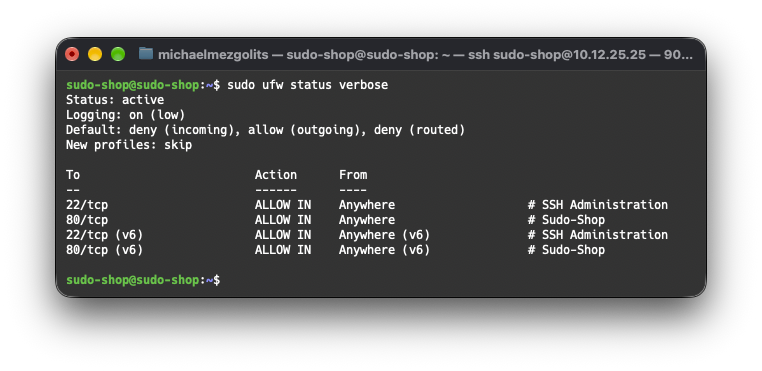
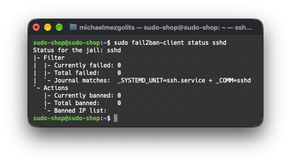
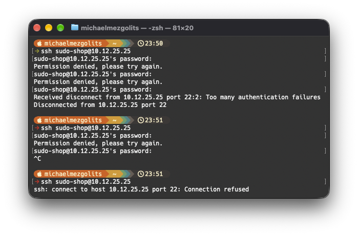

# Hardening der VM: ufw and fail2ban

Ziel laut Planung (S2.4, TB1):

- Von außen sind nur 22/tcp (SSH) und 80/tcp (Shop) erreichbar.
- fail2ban sperrt IP-Adressen nach mehreren fehlgeschlagenen SSH-Logins.

---

## ufw (Firewall)
```bash
sudo apt update
sudo apt install -y ufw

sudo ufw default deny incoming
sudo ufw default allow outgoing

sudo ufw allow 22/tcp comment 'SSH Administration'
sudo ufw allow 80/tcp comment 'Sudo-Shop'

sudo ufw enable
```

## fail2ban

Installieren:
```bash
sudo apt install -y fail2ban
```

Konfiguration (Bantime für Demonstration auf 2 Minuten gesetzt):
```bash
sudo tee /etc/fail2ban/jail.local > /dev/null <<'EOF'
[DEFAULT]
bantime  = 2m
findtime = 10m
maxretry = 5

[sshd]
enabled = true
port    = ssh
backend = systemd
EOF
```

Aktivieren:
```bash
sudo systemctl enable --now fail2ban
sudo systemctl restart fail2ban
```

Prüfen:
```bash
sudo systemctl status fail2ban --no-pager
sudo fail2ban-client status
sudo fail2ban-client status sshd
```

---

## Nachweis Umsetzung

### ufw

Status:


### fail2ban

Status:


Demonstration:


